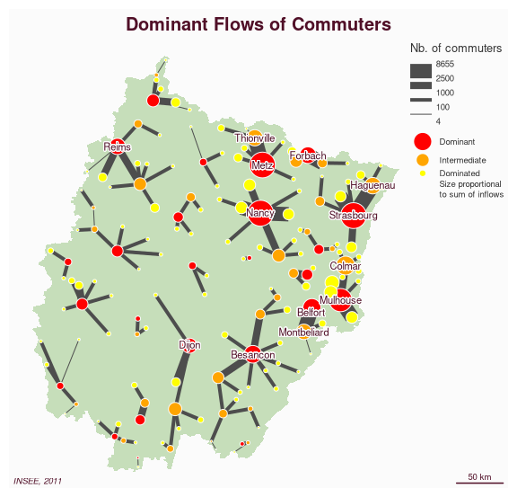

The `flows` package has been created to select flows from flow matrices, to compute statistics on selected flows, and to create cartographic and graphical visualisations of these flows. 

The analysis and representation of flows often presupposes selection to facilitate interpretation. Various methods have been proposed for selecting flows; one of the most widely used is based on major flows, selecting only the most important flows on a local or global scale, whether absolute or relative. While these methods often highlight hierarchies between locations, the loss of information caused by selection is rarely considered.    
We propose statistical indicators to assess this loss of information, as well as the characteristics of the selected flows. We provide functions that select flows (main, dominant, or major), compute statistics on the selected flows, and offer visualisations in the form of maps and graphs.

A [vignette](https://cran.r-project.org/web/packages/flows/vignettes/flows.html) explains how to use the package. 

The package was first published in 2015 alongside a paper by @beauguitte15.
It was removed from CRAN in 2020. 
The [version currently on CRAN](https://CRAN.R-project.org/package=flows) is a complete rewrite of the package and does not ensure backward compatibility. 
Development of the package is [hosted on Codeberg](https://codeberg.org/riatelab/flows).

